# sm-3ds-native

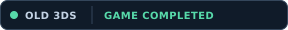 

[English](README.md) · [Descargas](https://github.com/NicolasBeatum/sm-3ds-native/releases/latest) · [Registro de cambios](CHANGELOG.md)

> [!IMPORTANT]
> **Port no oficial desarrollado con una participación amplia de IA.** NicolasBeatum dirige y prueba este proyecto; OpenAI Codex se ha usado para analizar código, implementar cambios, depurar, optimizar y escribir documentación. Es totalmente comprensible y respetable que alguien prefiera no jugar este port por haber utilizado IA. Este no es un lanzamiento oficial de Nintendo ni de los proyectos originales.

Port de Super Metroid para Nintendo 3DS, basado en [CharlesAverill/sm-3ds](https://github.com/CharlesAverill/sm-3ds) y en el [port de PC y decompilación de snesrev](https://github.com/snesrev/sm), con una pantalla inferior inspirada en MetroidArch.

## Estado actual

**Jugable y terminado de principio a fin en Old 3DS con el CIA de desarrollo.** Esto confirma una ruta al final, no el 100 % de objetos ni todas las rutas. Funciona en Old y New 3DS; el rendimiento varía según la sala y los ajustes.

La **0.2.0** incorpora iluminación atmosférica, mejoras del mapa, nuevos modos de HUD e interfaz en español e inglés.

## Funciones

- Juego nativo, sonido estéreo original y modo panorámico opcional.
- Iluminación atmosférica opcional: luces de ambiente, puertas, lava, Samus y algunos enemigos, con sombras cortas. **AJUSTES → VIDEO → LIGHTING**.
- Cinco modos de HUD superior: completo, solo vida, vida y minimapa, oculto con escenario ampliado o franja negra clásica. Los modos reducidos tienen fondo transparente.
- Mapas de área y del mundo con zoom, arrastre y seguimiento de Samus. QoL de objetos pendientes/recogidos (**OFF, ZERO/FUSION o SUPER METROID**), puertas de colores y salas con peligros o secretos.
- Estaciones con letras **E** (vida), **A** (munición) y **M** (mapa) en la pantalla inferior. **AJUSTES → MAPA → MEJORAS DEL MAPA**.
- Interfaz inferior en español e inglés, HUD configurable, equipamiento y ajustes guardados en la microSD. **AJUSTES → HUD → IDIOMA**.
- Selector de ROM, partidas independientes por ROM y dumps de diagnóstico con **L + R + A**.

Todos los cambios y correcciones están en el [registro de cambios](CHANGELOG.md).

## En imágenes

Capturas reales de **Azahar**; muestran el aspecto, no el rendimiento de una consola.

**Mapa actualizado:** **E** = recarga de vida · **A** = recarga de munición (ammo) · **M** = estación de mapas. Las letras aparecen en el mapa inferior; **S** sigue indicando guardado.

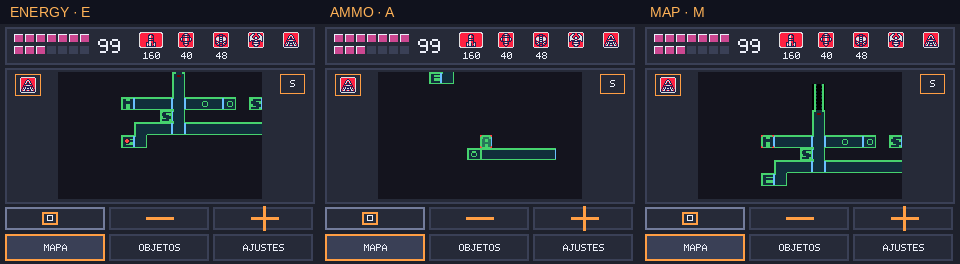

**HUD completo y HUD reducido transparente.**

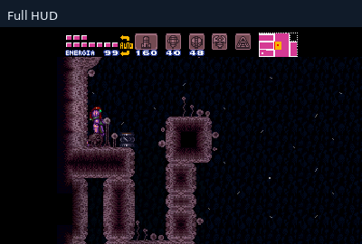

**Iluminación: apagada a la izquierda, encendida a la derecha.**

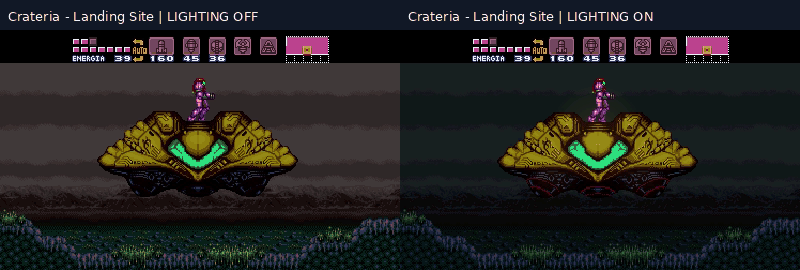

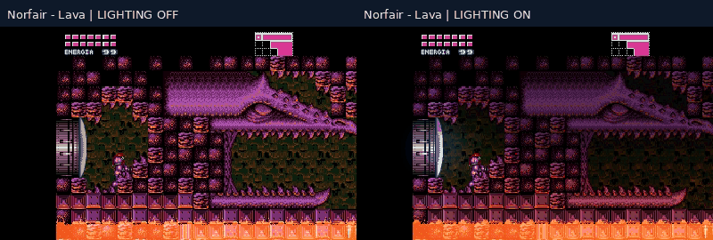

Ver los GIF de las demás zonas

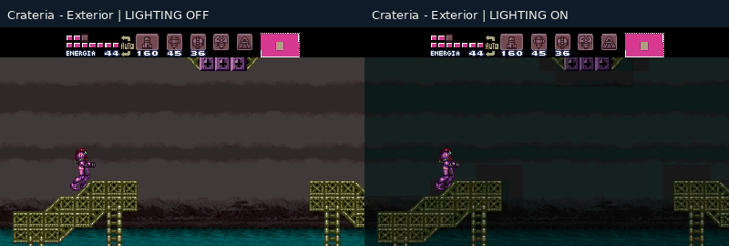

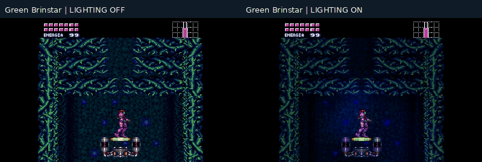

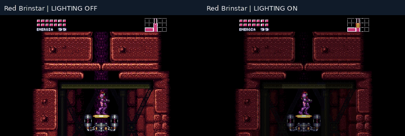

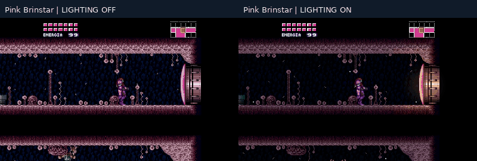

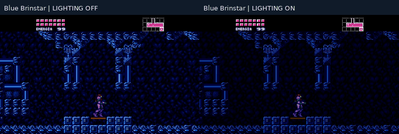

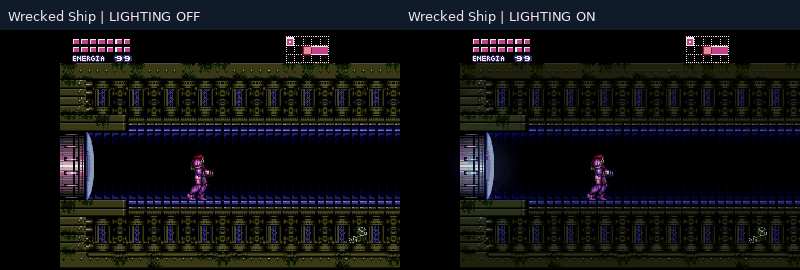

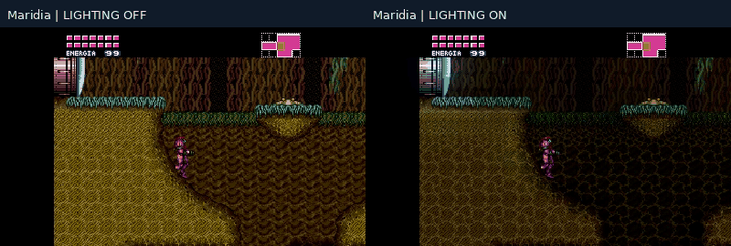

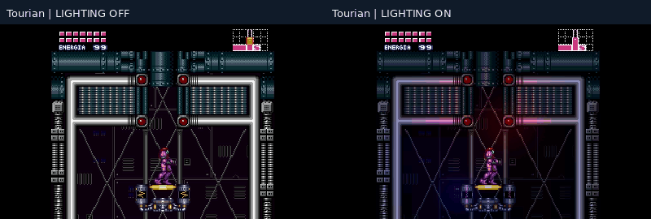

## Descarga e instalación

Descarga la **[versión 0.2.0](https://github.com/NicolasBeatum/sm-3ds-native/releases/tag/v0.2.0)**: **[CIA](https://github.com/NicolasBeatum/sm-3ds-native/releases/download/v0.2.0/SuperMetroid3DSPort.cia)** para FBI, o **[3DSX](https://github.com/NicolasBeatum/sm-3ds-native/releases/download/v0.2.0/SuperMetroid3DSPort.3dsx) + [SMDH](https://github.com/NicolasBeatum/sm-3ds-native/releases/download/v0.2.0/SuperMetroid3DSPort.smdh)** para Homebrew Launcher.

También puedes instalar el CIA con **FBI → Remote Install → Scan QR Code**:

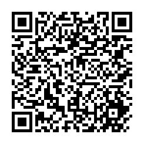

Coloca tu propia ROM compatible `.smc` o `.sfc` en `sdmc:/3ds/sm3dsnative/` y selecciónala al iniciar. Los paquetes no incluyen ROM ni parches. Al actualizar se conservan las partidas en `saves/` y los ajustes en `settings.cfg`.

[Compilación y diagnósticos](docs/BUILDING.md) · [Notas del port](docs/PORTING_NOTES.md)

Créditos, licencias y uso de IA

Este repositorio integra varios proyectos independientes; no se presenta como un trabajo enteramente original:

| Proyecto | Participación |
| --- | --- |
| [CharlesAverill/sm-3ds](https://github.com/CharlesAverill/sm-3ds) | Base del port para Nintendo 3DS. |
| [CharlesAverill/sm-3ds-lib](https://github.com/CharlesAverill/sm-3ds-lib) | Submódulo de la lógica nativa y decompilación usado por el port. |
| [snesrev/sm](https://github.com/snesrev/sm) | Decompilación original de Super Metroid y port de PC. |
| [libsdl-org/SDL](https://github.com/libsdl-org/SDL) | Capa de plataforma, entrada y sonido. |
| [Raekwon1603/RetroArch, rama `metroidarch-dual-screen`](https://github.com/Raekwon1603/RetroArch/tree/metroidarch-dual-screen) | Referencia visual de la pantalla inferior y origen de código de interfaz, decodificación de datos de la ROM e ilustración Redux. |
| [EstebanPdN/zelda-alttp-3ds](https://github.com/EstebanPdN/zelda-alttp-3ds) | Referencia para organizar dumps y estadísticas de rendimiento de toda la sesión. |

La implementación de la pantalla inferior y los datos de la ilustración Redux derivan de la rama MetroidArch bajo GPL-3.0. El port integrado se distribuye bajo GPL-3.0; se conserva el aviso MIT de CharlesAverill en `LICENSE.MIT`, y los submódulos mantienen sus licencias originales. Consulta [THIRD_PARTY_NOTICES.md](THIRD_PARTY_NOTICES.md) para conocer el origen del código y los recursos. Los bytes de la ilustración Redux fueron extraídos de una ROM modificada; la licencia GPL del código no establece la propiedad de esos gráficos. Super Metroid, su música y sus gráficos pertenecen a Nintendo y a sus respectivos titulares.

Los submódulos públicos son los forks [NicolasBeatum/sm-3ds-lib-native-fork](https://github.com/NicolasBeatum/sm-3ds-lib-native-fork) y [NicolasBeatum/SDL-3DS-native-fork](https://github.com/NicolasBeatum/SDL-3DS-native-fork). Sus relaciones de fork identifican los proyectos originales; las ramas de `.gitmodules` contienen los cambios específicos del port.

NicolasBeatum aporta la dirección del proyecto y las pruebas de aceptación. OpenAI Codex se ha usado ampliamente para borradores de implementación, comparación de código, análisis de rendimiento, integración de PICA200 y la interfaz inferior, diagnóstico de errores, pruebas automatizadas y documentación. Las decisiones de aceptar cambios y publicar corresponden al responsable humano del repositorio. El uso de IA no cambia las licencias, los derechos de autor ni las atribuciones obligatorias de los proyectos originales.

Si prefieres no jugar un port desarrollado con ayuda de IA, esa decisión se entiende y se respeta totalmente. Esta declaración permite decidir con esa información disponible.

